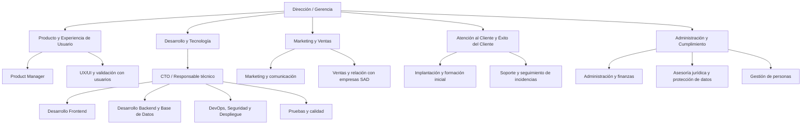

# Estructura organizativa de CUIDALIA

## 1. Introducción

CUIDALIA es una propuesta de plataforma web orientada a empresas de servicios de ayuda a domicilio (SAD). Su finalidad es centralizar información y procesos que actualmente pueden encontrarse repartidos entre cuadrantes, llamadas, hojas de cálculo y registros en papel. La plataforma conecta a tres perfiles principales: coordinación, profesionales de atención directa y familiares de las personas atendidas.

La propuesta de valor se centra en facilitar la coordinación diaria y la gestión de sustituciones, con una evolución prevista hacia el registro de visitas y tareas, la comunicación con las familias y la continuidad contextual de la atención. La viabilidad técnica plantea el uso del stack MERN MongoDB, Express.js, React y Node.js y una implementación gradual que priorice el recorrido principal del MVP antes de ampliar funcionalidades.

Este documento define **la estructura organizativa que podría adoptar CUIDALIA si se convirtiera en una empresa real**. No describe la distribución actual de las tareas académicas del equipo, sino una propuesta empresarial que deberá validarse si el proyecto avanza hacia su comercialización.

## 2. Tipo de empresa y modelo de negocio

### 2.1. Tipo de empresa

Se propone crear una **startup tecnológica especializada en software para la gestión de servicios de ayuda a domicilio**. La solución se comercializaría principalmente a empresas SAD que necesiten organizar turnos, gestionar bajas y sustituciones y coordinar a sus profesionales.

### 2.2. Modelo de negocio propuesto

El modelo que se considera más adecuado inicialmente es **B2B SaaS** (*Business to Business – Software as a Service*): las empresas clientes accederían a CUIDALIA mediante una aplicación web alojada en la nube y pagarían una cuota periódica por utilizarla.

Como hipótesis comercial inicial, se podrían estudiar planes de suscripción según el tamaño de la empresa, el número de profesionales o el volumen de servicios gestionados. Los precios, límites y condiciones definitivos no están fijados en la documentación disponible y tendrían que establecerse mediante investigación de mercado, entrevistas con empresas SAD y una estimación de los costes reales.

Los familiares y trabajadores serían usuarios de la plataforma vinculados a la empresa cliente, no necesariamente clientes que contraten una suscripción individual. Este planteamiento mantiene el foco comercial en las organizaciones que coordinan los servicios.

## 3. Estructura organizativa propuesta

### 3.1. Tipo de estructura

Se propone una **estructura funcional, horizontal y ligera**, apropiada para una startup en su fase inicial. La dirección establecería objetivos comunes y coordinaría las áreas funcionales, pero los equipos de producto y desarrollo trabajarían de forma cercana para priorizar, construir y validar las funcionalidades.

La estructura no implica que cada departamento necesite desde el primer día una plantilla independiente. En la fase inicial, una misma persona puede asumir varias responsabilidades y algunos servicios especializados por ejemplo, asesoramiento jurídico, fiscal o de protección de datos podrían contratarse externamente.

### 3.2. Organigrama

El siguiente organigrama representa la estructura funcional propuesta. Se puede visualizar directamente en GitHub si el visor admite Mermaid.

### 3.3. Departamentos y funciones

#### Dirección / Gerencia

**Objetivo:** definir la estrategia de la empresa, asegurar su viabilidad y coordinar las áreas funcionales.

Funciones principales:

- Definir la misión, los objetivos de negocio y la hoja de ruta general de CUIDALIA.
- Decidir las prioridades de inversión y el alcance de cada versión del producto.
- Coordinar los departamentos y resolver conflictos de prioridades.
- Supervisar el presupuesto, los ingresos, los costes y las necesidades de financiación.
- Establecer acuerdos con empresas SAD, proveedores tecnológicos y posibles colaboradores.
- Revisar indicadores de negocio, calidad y satisfacción de los clientes.

En la etapa inicial, la Dirección también podría asumir parte de la gestión de producto y de las relaciones comerciales.

#### Departamento de Desarrollo y Tecnología

**Objetivo:** diseñar, implementar, probar y mantener la plataforma.

Se considera el área técnica principal porque CUIDALIA es un producto de software y su propuesta depende de que el flujo de trabajo sea estable, seguro y sencillo de utilizar.

**CTO o responsable técnico**

- Define la arquitectura de la aplicación y las decisiones técnicas.
- Establece criterios de calidad del código, revisiones y buenas prácticas.
- Coordina las tareas de frontend, backend, base de datos e infraestructura.
- Evalúa riesgos técnicos, dependencias y necesidades de escalabilidad.

**Desarrollo frontend**

- Implementa las interfaces con React y las herramientas seleccionadas.
- Construye las vistas adaptadas a los distintos roles: coordinación, trabajador y, cuando se incorpore, familiar.
- Cuida la usabilidad, la navegación, la adaptación a dispositivos y la accesibilidad.
- Conecta las interfaces con la API y comunica de forma comprensible los estados de carga y los errores.

**Desarrollo backend y base de datos**

- Construye la API con Node.js y Express.
- Diseña los modelos y las consultas de MongoDB.
- Implementa la lógica de turnos, disponibilidad, sustituciones y aceptación del servicio.
- Valida las peticiones y comprueba los permisos en el servidor.
- Aplica medidas de seguridad para impedir accesos no autorizados a los datos.

**DevOps, infraestructura y seguridad**

- Configura los entornos de desarrollo y despliegue.
- Gestiona la configuración, las variables de entorno y los secretos.
- Automatiza pruebas y despliegues mediante CI/CD cuando proceda.
- Supervisa disponibilidad, registros de errores, copias de seguridad y recuperación.
- Revisa la configuración de los servicios cloud y sus límites.

**Calidad y pruebas (QA)**

- Define escenarios de prueba a partir de los requisitos y criterios de aceptación.
- Comprueba los casos principales de sustitución: servicio afectado por baja, candidato disponible, conflicto horario, asignación y aceptación.
- Realiza pruebas unitarias, de integración y de interfaz cuando correspondan.
- Registra defectos, comprueba las correcciones y evita que se cierren tareas sin verificación.

En una plantilla pequeña, estas funciones podrían repartirse entre varios perfiles de desarrollo en lugar de contar con una persona exclusiva por especialidad.

#### Departamento de Producto y Experiencia de Usuario (UX/UI)

**Objetivo:** asegurar que CUIDALIA resuelve necesidades reales y que sus funcionalidades se desarrollan en el orden adecuado.

**Product Manager**

- Recoge necesidades de empresas SAD, coordinadores, trabajadores y familiares.
- Mantiene y prioriza el backlog del producto.
- Define requisitos, objetivos y criterios de aceptación con el equipo técnico.
- Decide, junto con Dirección y el equipo, qué funcionalidades entran en cada versión.
- Valida las hipótesis de producto con entrevistas, prototipos y pruebas de usabilidad.

**Diseño UX/UI**

- Diseña los recorridos y las interfaces para cada perfil.
- Procura que las acciones frecuentes como localizar una baja y asignar una sustitución se puedan completar de forma clara y eficiente.
- Define componentes visuales coherentes y revisa contraste, navegación por teclado, textos y accesibilidad.
- Prueba los prototipos con personas usuarias y utiliza los resultados para proponer mejoras.

En la fase inicial, el Product Manager y el perfil de diseño podrían colaborar estrechamente y compartir tareas de investigación y validación.

#### Departamento de Marketing y Ventas

**Objetivo:** dar a conocer CUIDALIA, captar organizaciones clientes y comprender las necesidades del mercado.

Funciones principales:

- Identificar empresas SAD que puedan beneficiarse de la plataforma.
- Preparar demostraciones del producto y materiales comerciales.
- Gestionar contactos, reuniones y oportunidades de venta.
- Estudiar la competencia y mantener actualizada la propuesta de valor.
- Elaborar contenidos de comunicación y mantener los canales comerciales.
- Recoger objeciones y necesidades detectadas durante el proceso de venta y trasladarlas a Producto.
- Analizar la conversión comercial, la retención y la satisfacción de las empresas clientes.

La estrategia debe presentar como diferenciación que se pretende validar la mejora de la coordinación y la continuidad de la atención, sin afirmar que esos beneficios estén demostrados hasta realizar pruebas con usuarios reales.

#### Departamento de Atención al Cliente y Éxito del Cliente

**Objetivo:** ayudar a las empresas a incorporar CUIDALIA a su operativa y resolver los problemas de uso.

Funciones principales:

- Acompañar a las empresas durante la configuración inicial.
- Preparar guías y sesiones de formación para coordinadores y trabajadores.
- Resolver dudas sobre el uso de la aplicación y registrar incidencias.
- Clasificar los problemas según su impacto y trasladar los errores técnicos a Desarrollo.
- Recopilar comentarios sobre usabilidad y necesidades de mejora.
- Comprobar que las empresas clientes aprovechan las funciones contratadas y realizar seguimiento de su satisfacción.

Este departamento será relevante porque los usuarios pueden tener distintos niveles de experiencia digital y la plataforma debe integrarse en rutinas de trabajo reales. En el inicio, la atención al cliente podría estar cubierta por la persona responsable de implantación y por Dirección o Producto.

#### Departamento de Administración y Cumplimiento

**Objetivo:** mantener el control económico y administrativo de la empresa y coordinar el cumplimiento de sus obligaciones.

**Administración y finanzas**

- Gestionar presupuestos, facturas, cobros, pagos y previsiones de tesorería.
- Controlar los costes de desarrollo, infraestructura, licencias y servicios externos.
- Preparar informes económicos y colaborar en las decisiones de financiación.
- Mantener la documentación administrativa de la empresa.

**Gestión de personas (RR. HH.)**

- Coordinar la contratación, incorporación y formación del equipo.
- Definir responsabilidades y facilitar el desarrollo profesional.
- Dar seguimiento a la distribución de la carga de trabajo y al clima del equipo.

**Asesoría jurídica, protección de datos y cumplimiento**

- Coordinar la revisión de contratos, condiciones de servicio y documentación legal.
- Revisar con asesoramiento especializado el tratamiento de datos personales y, especialmente, de la información sensible que pudiera manejar la plataforma.
- Supervisar las medidas y procedimientos de privacidad, seguridad y atención de derechos.
- Comprobar las licencias de recursos de terceros y las condiciones de los servicios externos.
- Determinar, con asesoramiento adecuado, qué obligaciones sectoriales y autorizaciones resultan aplicables al modelo de negocio real.

No se presupone que sea obligatorio disponer de un departamento jurídico propio ni designar un Delegado de Protección de Datos en todos los casos. La necesidad concreta deberá evaluarse según las actividades y tratamientos que se realicen.

## 4. Tamaño inicial del equipo

Para una hipotética puesta en marcha comercial se propone una **plantilla inicial de seis personas**, complementada con servicios externos cuando sea necesario. Esta cifra es una estimación de organización, no un dato de una empresa existente ni un coste ya presupuestado.

| Perfil inicial | Responsabilidades principales | Áreas que puede cubrir |
|---|---|---|
| 1. Dirección y Producto | Estrategia, priorización, relación con clientes piloto y coordinación general. | Dirección / Gerencia y parte de Producto. |
| 2. CTO o responsable técnico | Arquitectura, decisiones técnicas, revisión de código y coordinación de Desarrollo. | Dirección técnica y Desarrollo. |
| 3. Desarrollador/a full stack | API, reglas de negocio, modelos de datos y colaboración en frontend. | Backend y parte de calidad. |
| 4. Desarrollador/a frontend con enfoque UX/UI | Interfaces, accesibilidad, adaptación móvil y validación de recorridos. | Frontend y Producto / UX/UI. |
| 5. Responsable comercial y marketing | Prospección de empresas SAD, demostraciones, comunicación y ventas. | Marketing y Ventas. |
| 6. Responsable de implantación y soporte | Configuración para clientes, formación, soporte y recopilación de incidencias. | Atención al Cliente y Éxito del Cliente. |

La administración, contabilidad, asesoría jurídica y las revisiones especializadas de protección de datos podrían contratarse a profesionales externos en la fase inicial. La asignación concreta se revisaría según los recursos disponibles y el volumen real de clientes.

## 5. Justificación de la estructura elegida

Se propone una estructura funcional y horizontal por cinco motivos:

1. **Tamaño inicial reducido.** Una startup no necesita crear desde el principio departamentos grandes y aislados. Compartir responsabilidades y recurrir a especialistas externos permite contener los costes mientras se valida el producto.
2. **Colaboración continua entre Producto y Desarrollo.** El MVP debe priorizar un recorrido concreto: identificar un servicio afectado por una baja, consultar candidatos válidos, asignar un sustituto y confirmar su aceptación. La proximidad entre quienes definen la funcionalidad y quienes la implementan reduce malentendidos y ayuda a mantener el alcance controlado.
3. **Necesidad de seguridad y privacidad.** CUIDALIA podría llegar a tratar datos personales, ubicaciones e información relacionada con los cuidados. Por ello, la seguridad, los permisos y la privacidad deben formar parte del trabajo técnico y no considerarse tareas añadidas al final.
4. **Importancia de la validación con usuarios.** La plataforma se dirige a perfiles distintos, con necesidades diferentes. Producto, diseño y Atención al Cliente deben comprobar que los recorridos resultan comprensibles y que las funcionalidades aportan valor real.
5. **Escalabilidad gradual.** La estructura permite incorporar personas a áreas concretas solo cuando aumenten las necesidades de desarrollo, ventas, soporte o cumplimiento.

La organización propuesta también ayuda a controlar el principal riesgo identificado en la viabilidad técnica: intentar construir demasiadas funcionalidades antes de completar e integrar el recorrido prioritario del MVP.

## 6. Evolución de la empresa y escalabilidad

La organización podría evolucionar en tres etapas:

### Etapa 1. Validación del MVP

- Mantener un equipo pequeño y multidisciplinar.
- Desarrollar y probar el recorrido de sustitución con datos ficticios.
- Realizar entrevistas y pruebas con potenciales usuarios del sector SAD.
- Validar la utilidad del producto antes de comprometer recursos en funciones avanzadas.
- Contratar apoyo externo para necesidades jurídicas, contables o especializadas que el equipo no pueda cubrir.

### Etapa 2. Primeros clientes

- Reforzar Atención al Cliente para ofrecer incorporación, formación y soporte.
- Incorporar capacidad comercial si la prospección y las ventas requieren dedicación estable.
- Formalizar procesos de pruebas, despliegue, monitorización, copias de seguridad y respuesta a incidencias.
- Priorizar mejoras basadas en el uso real y en los comentarios de las empresas clientes.

### Etapa 3. Crecimiento

- Ampliar Desarrollo con perfiles especializados en frontend, backend, infraestructura y calidad según las necesidades.
- Crear una función de Producto y UX/UI más diferenciada si aumenta el número de usuarios y funcionalidades.
- Reforzar Marketing y Ventas para acceder a nuevas organizaciones y zonas geográficas.
- Profesionalizar el soporte mediante niveles de atención y documentación de ayuda.
- Revisar periódicamente la estructura de administración, seguridad y cumplimiento conforme crezcan la plantilla y los tratamientos de datos.

La contratación de nuevos perfiles no debe depender solo del número de usuarios, sino también del volumen de servicios gestionados, la carga de soporte, los requisitos de disponibilidad y la complejidad técnica.

## 7. Coordinación entre departamentos

La empresa utilizaría un sistema de trabajo iterativo. Las necesidades detectadas por Ventas, Atención al Cliente o las pruebas con usuarios se trasladarían a Producto. Producto las convertiría en requisitos priorizados y Desarrollo estimaría su esfuerzo, identificaría dependencias y planificaría la implementación.

El proceso propuesto sería:

1. **Detección de necesidad:** una empresa cliente, un trabajador o un familiar comunica un problema o una propuesta.
2. **Análisis:** Producto evalúa la necesidad, su relevancia para el MVP y los riesgos asociados.
3. **Priorización y estimación:** Dirección / Producto acuerda la prioridad y Desarrollo estima el trabajo.
4. **Implementación:** Desarrollo construye la funcionalidad y realiza pruebas.
5. **Validación:** Producto y usuarios de prueba comprueban el resultado según los criterios de aceptación.
6. **Despliegue y seguimiento:** se publica la versión, se monitorizan errores y Atención al Cliente comunica incidencias relevantes.
7. **Mejora continua:** las observaciones vuelven al backlog para decidir si requieren una corrección o una futura mejora.

## 8. Conclusión

La estructura propuesta para CUIDALIA combina una dirección pequeña con áreas funcionales claramente identificadas: Desarrollo y Tecnología, Producto y UX/UI, Marketing y Ventas, Atención al Cliente y Administración y Cumplimiento. De esta forma se cubren tanto las necesidades de creación y mantenimiento del software como las de comercialización, implantación y gestión de una empresa real.

La elección de una estructura funcional y horizontal resulta adecuada para una startup en fase inicial porque facilita la colaboración, permite combinar responsabilidades y mantiene la posibilidad de crecer por departamentos. La propuesta parte de la necesidad de ayudar a las empresas SAD a organizar sus servicios y gestionar las sustituciones con mayor claridad, pero la viabilidad comercial y la diferenciación deberán validarse con organizaciones y usuarios reales.

